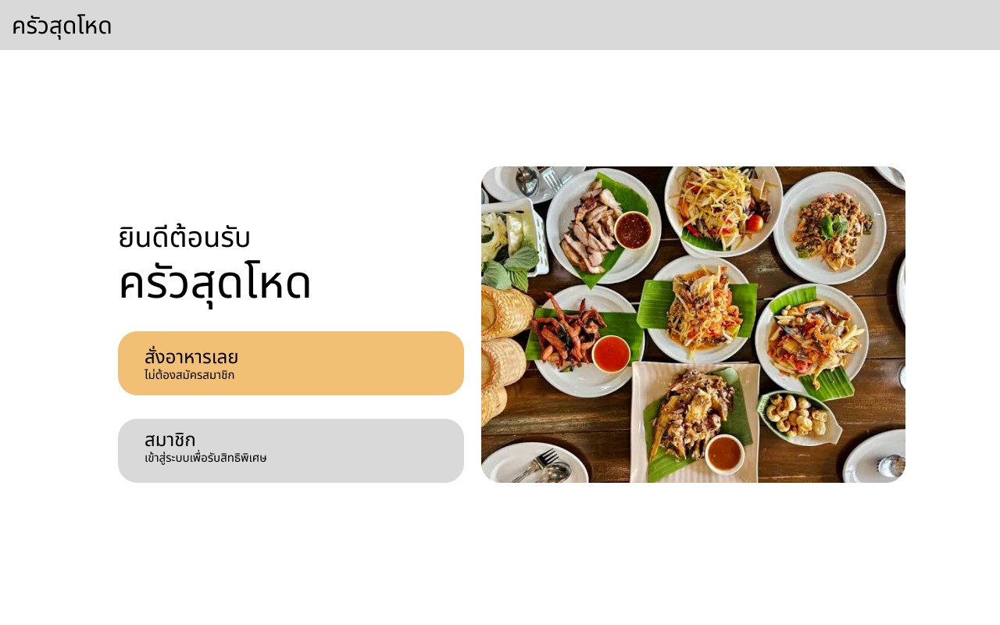
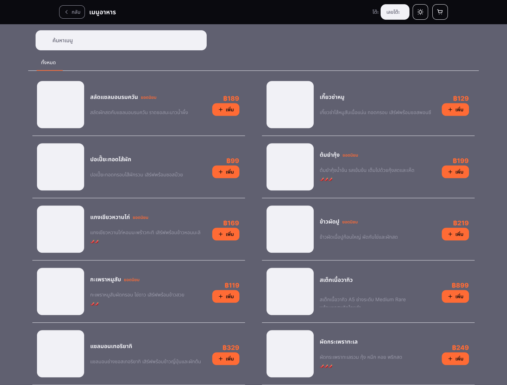
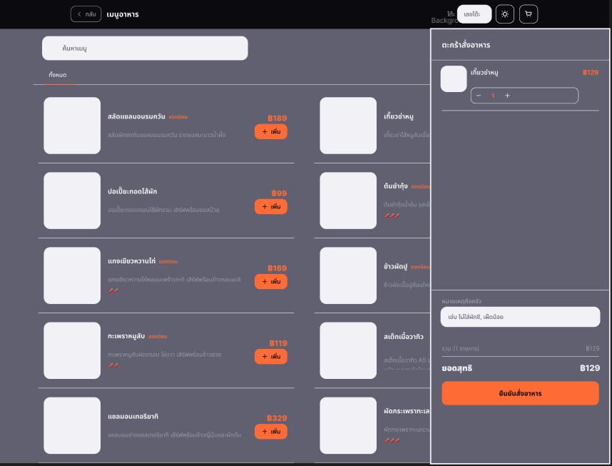
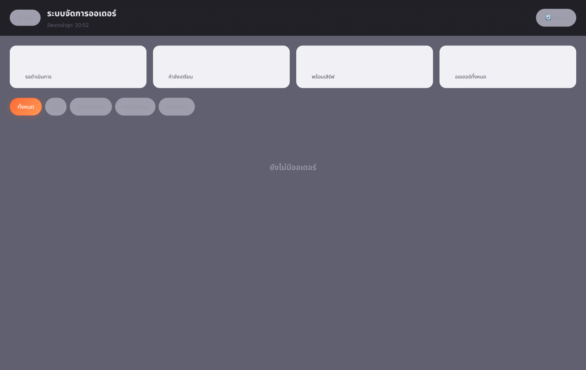
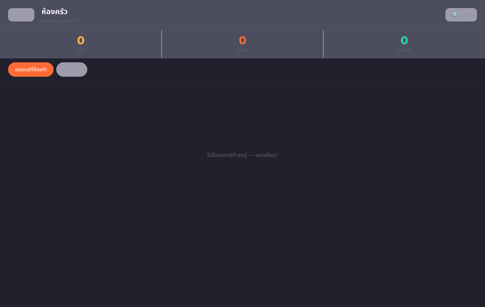
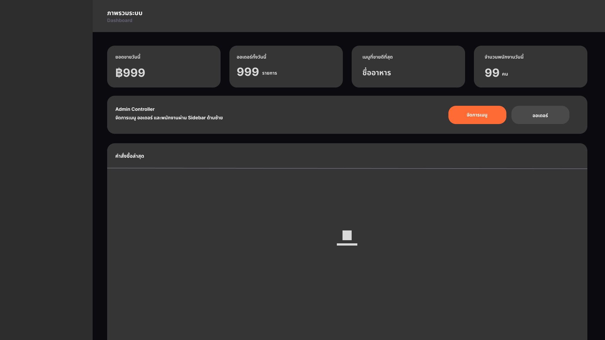
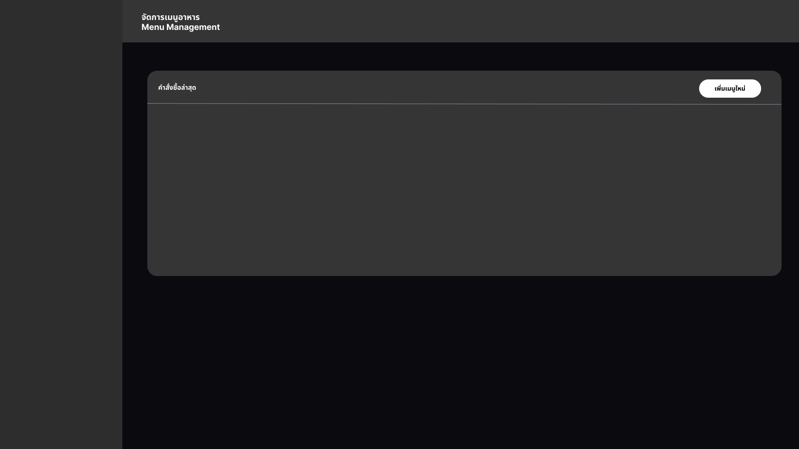
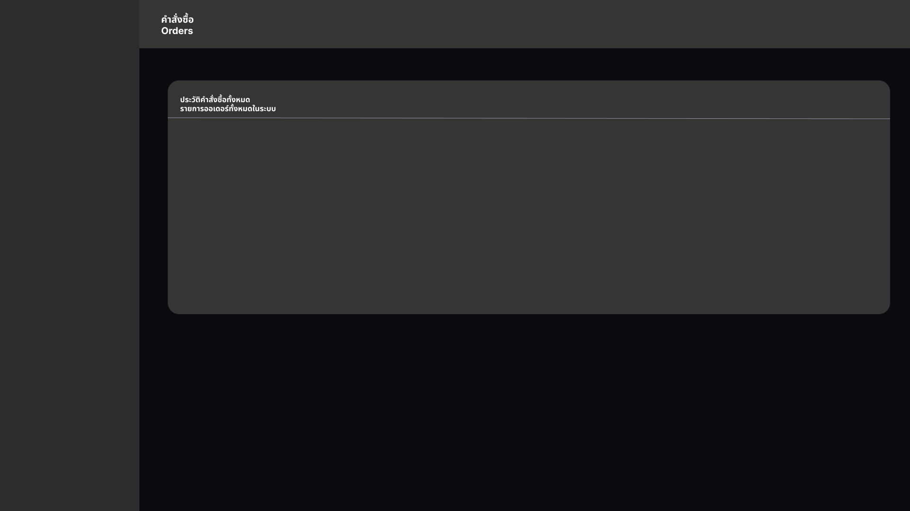
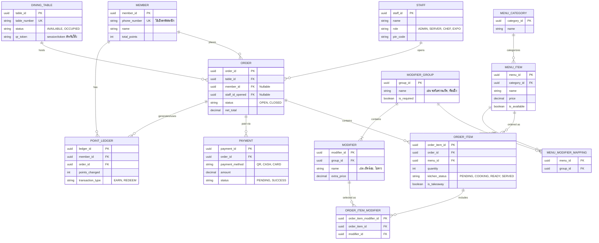

# 🍽️ Comprehensive Restaurant Management & POS System
### ระบบจัดการร้านอาหารและสั่งอาหารครบวงจร (Cloud-based Smart Restaurant Solution)

[](https://nextjs.org/)
[](https://react.dev/)
[](https://tailwindcss.com/)
[]()
[-green?style=for-the-badge)]()

---

## 📖 บทนำ (Introduction)

โปรเจกต์นี้คือการพัฒนาระบบจัดการร้านอาหารและสั่งอาหารครบวงจร (**Comprehensive Restaurant Management & POS System**) ที่ออกแบบมาเพื่อยกระดับและเพิ่มมาตรฐานการให้บริการของร้านอาหารทั่วไป ระบบถูกสร้างขึ้นบนสถาปัตยกรรมแบบ **Cloud-based** เพื่อเชื่อมโยงประสบการณ์ของลูกค้า พนักงานหน้าร้าน และพนักงานในครัวเข้าด้วยกันแบบเรียลไทม์ (Real-time Synchronization) 

หัวใจสำคัญของการออกแบบระบบมุ่งเน้นไปที่:
- **ความยืดหยุ่นในการใช้งานสูง**: รองรับร้านอาหารตั้งแต่ขนาดเล็กไปจนถึงขนาดใหญ่
- **ลดความซับซ้อนของอุปกรณ์ฮาร์ดแวร์**: ใช้งานผ่านเว็บเบราว์เซอร์บนอุปกรณ์ใดก็ได้ (แท็บเล็ต, สมาร์ทโฟน, หน้าจอสัมผัส หรือคอมพิวเตอร์)
- **Zero-Friction User Experience**: ลูกค้าสามารถสั่งอาหาร ดูรายการบิล และสะสมแต้มได้ทันทีผ่าน Web POS ประจำโต๊ะ **โดยไม่ต้องดาวน์โหลดแอปพลิเคชันใดๆ เพิ่มเติม**

---

## 💡 หลักการและเหตุผล (Problem Statement & Rationale)

การพัฒนาระบบนี้มีจุดประสงค์เพื่อแก้ไขปัญหาคอขวด (**Bottlenecks**) และจุดบกพร่องที่เกิดขึ้นเป็นประจำในการดำเนินงานของร้านอาหารแบบดั้งเดิม โดยมีหลักเหตุผลสำคัญ 4 ประการ ดังนี้:

### 1. ลดข้อผิดพลาดและเพิ่มความเร็วในการบริการ (Speed & Accuracy)
* **ปัญหาเดิม**: พนักงานต้องเดินไปรับออเดอร์ จดใส่กระดาษ แล้วนำไปคีย์เข้าระบบ ซึ่งมักเกิดข้อผิดพลาดในการจด การส่งออเดอร์ล่าช้า และเสียเวลาเดินไปมา
* **แนวทางแก้ไข**: ให้ลูกค้าสามารถสั่งอาหาร เลือกออปชันพิเศษ (Modifiers) และตรวจสอบบิลได้ด้วยตนเองผ่าน Web POS ประจำโต๊ะ ช่วยลดภาระงานรูทีนของพนักงาน ทำให้พนักงานมีเวลาโฟกัสกับการต้อนรับ ดูแลลูกค้าอย่างใกล้ชิด และแก้ไขปัญหาเฉพาะหน้าได้อย่างมีประสิทธิภาพ

### 2. เพิ่มประสิทธิภาพการสื่อสารในครัว (Zero Communication Gap)
* **ปัญหาเดิม**: ตั๋วกระดาษในครัวสูญหาย ลำดับการทำอาหารสับสน และขาดการประสานงานระหว่างคนทำอาหารกับคนยกเสิร์ฟ ทำให้อาหารออกช้าหรือเสิร์ฟผิดโต๊ะ
* **แนวทางแก้ไข**: ใช้ระบบ **Kitchen Display System (KDS)** บนหน้าจอแยกฟังก์ชันชัดเจนระหว่าง:
  * **เชฟ (Chef)**: จัดการคิวปรุงอาหารตามลำดับ และอัปเดตสถานะอาหารแบบเรียลไทม์
  * **พนักงานตรวจอาหาร (Expeditor / EXPO)**: ควบคุมคุณภาพ จัดเซ็ตอาหารให้ครบตามโต๊ะก่อนยกเสิร์ฟ ป้องกันปัญหาออเดอร์ตกหล่น ทำซ้ำ หรือเสิร์ฟผิดโต๊ะ 100%

### 3. กระตุ้นยอดขายด้วยระบบสมาชิกรวมศูนย์ (Frictionless Loyalty Program)
* **ปัญหาเดิม**: การสมัครสมาชิกร้านอาหารส่วนใหญ่บังคับให้ลูกค้าดาวน์โหลดแอปพลิเคชันหรือกรอกข้อมูลยุ่งยาก ทำให้ลูกค้าส่วนใหญ่ปฏิเสธการเข้าร่วม
* **แนวทางแก้ไข**: รวบรวมระบบสะสมแต้มและโปรโมชันไว้ในหน้าจอสั่งอาหารที่โต๊ะโดยตรง โดยระบุตัวตนด้วย **"เบอร์โทรศัพท์"** เพียงอย่างเดียว ลูกค้าสามารถสะสมแต้มและแลกรับสิทธิประโยชน์ได้ทันทีในขั้นตอนการสั่งอาหาร ช่วยกระตุ้นยอดขายและสร้างแรงจูงใจให้ลูกค้ากลับมาใช้บริการซ้ำ

### 4. ความต่อเนื่องทางธุรกิจ (Business Continuity)
* **ปัญหาเดิม**: เมื่อระบบอินเทอร์เน็ตของร้านหรือ Wi-Fi ขัดข้อง การรับออเดอร์และการดำเนินงานทั้งหมดจะหยุดชะงักทันที
* **แนวทางแก้ไข**: สถาปัตยกรรมระบบรองรับแผนสำรอง (Contingency Plan) ในกรณีที่เครือข่ายส่วนกลางของร้านมีปัญหา พนักงานสามารถใช้อุปกรณ์ส่วนตัวผ่านเครือข่ายโทรศัพท์มือถือ (**4G/5G**) เข้าสู่ระบบ Staff Portal เพื่อรับออเดอร์แทนลูกค้า และส่งข้อมูลตรงเข้าสู่ระบบได้ทันที ทำให้ร้านอาหารดำเนินกิจการได้อย่างราบรื่นไม่มีสะดุด

---

## 👥 บทบาทผู้ใช้งานในระบบ (System Roles & Modules)

```
┌─────────────────────────────────────────────────────────────────────────┐
│                    Cloud-based Restaurant Ecosystem                     │
├─────────────────┬──────────────────┬─────────────────┬──────────────────┤
│ 📱 ลูกค้า       │ 🧑‍💼 พนักงานหน้าร้าน│ 👨‍🍳 ในครัว       │ 📋 การจัดการ     │
│ (Customer/Guest)│ (Server/Staff)   │ (Chef & Expo)   │ (Admin/Cashier)  │
├─────────────────┼──────────────────┼─────────────────┼──────────────────┤
│ • สั่งอาหารที่โต๊ะ   │ • เปิด/จัดโต๊ะ     │ • หน้าจอ Chef   │ • เช็คบิล/ชำระเงิน  │
│ • เลือก Modifier│ • รับออเดอร์แทนลูกค้า│ (คิวปรุงอาหาร)  │ (QR, Cash, Card) │
│ • สะสมแต้มเบอร์โทร │ • จัดการสถานะโต๊ะ  │ • หน้าจอ Expo   │ • จัดการเมนู/หมวดหมู่│
│ • เช็คสถานะอาหาร  │ • โหมดฉุกเฉิน 4G/5G│ (ตรวจอาหาร/เสิร์ฟ)│ • จัดการสิทธิ์ Staff │
└─────────────────┴──────────────────┴─────────────────┴──────────────────┘
```

---

## 🎨 การออกแบบหน้าจอใช้งาน (Wireframe & UI Design)

หน้าจอทั้งหมดในระบบถูกออกแบบมาเพื่อรองรับผู้ใช้งาน 3 กลุ่มหลัก ซึ่งแต่ละกลุ่มมีหน้าที่และความต้องการที่แตกต่างกัน โดยมีหลักการออกแบบที่เน้น **ความเรียบง่าย**, **ความรวดเร็ว**, และ **ความแม่นยำ** ในการปฏิบัติงานจริง

---

### 👤 ฝั่งลูกค้า (Customer Portal)

> หน้าจอที่ลูกค้าจะพบเมื่อสแกน QR Code ที่โต๊ะ ออกแบบให้ใช้งานง่าย ไม่ต้องล็อกอิน และรองรับการสั่งอาหารด้วยตนเองแบบครบวงจร

| หน้าจอ | ตัวอย่าง UI |
| :--- | :---: |
| **🏠 หน้าแรก** (`/`) — เลือกสั่งอาหารแบบ Guest หรือเข้าสู่ระบบสมาชิกด้วยเบอร์โทรเพื่อสะสมแต้ม |  |
| **🍽️ หน้าเมนูอาหาร** (`/order`) — เรียกดูเมนูตามหมวดหมู่ เลือก Modifier และเพิ่มลงตะกร้า |  |
| **🛒 หน้าเมนูพร้อมสรุปออเดอร์** (`/order`) — แสดง Sidebar/Navbar สรุปรายการและยอดรวมแบบ Real-time |  |

---

### 🧑‍💼 ฝั่งพนักงานและห้องครัว (Staff & Kitchen)

> หน้าจอสำหรับพนักงานหน้าร้านและเชฟในครัว ออกแบบให้มองเห็นสถานะออเดอร์ได้ชัดเจน อัปเดตได้รวดเร็ว และลดข้อผิดพลาดในการสื่อสาร

| หน้าจอ | ตัวอย่าง UI |
| :--- | :---: |
| **🧾 Staff Order Tracker** (`/staff`) — พนักงานเสิร์ฟตรวจสอบสถานะออเดอร์ทุกโต๊ะ รับออเดอร์สำรองได้ |  |
| **👨‍🍳 Kitchen Display System** (`/chef`) — หน้าจอ KDS สำหรับเชฟจัดคิวปรุงอาหาร อัปเดตสถานะ PENDING → COOKING → READY |  |

---

### 📋 ฝั่งผู้ดูแลระบบ (Admin Panel)

> ศูนย์บัญชาการของร้านอาหาร ผู้ดูแลระบบสามารถดู Dashboard ภาพรวม, บริหารจัดการเมนู CRUD และตรวจสอบประวัติคำสั่งซื้อทั้งหมด

| หน้าจอ | ตัวอย่าง UI |
| :--- | :---: |
| **📊 Dashboard** (`/admin`) — ภาพรวมร้านอาหาร สถิติยอดขาย สถานะโต๊ะ และรายงานสรุป |  |
| **🍜 Menu Management** (`/admin`) — บริหารจัดการเมนูอาหารแบบ CRUD เพิ่ม/แก้ไข/ลบ หมวดหมู่และรายการเมนู |  |
| **📜 Order History** (`/admin`) — ดูประวัติคำสั่งซื้อทั้งหมด กรองตามวันที่ โต๊ะ และสถานะการชำระเงิน |  |

---

## 🗄️ การออกแบบฐานข้อมูล (Database Design & ER Diagram)

ระบบถูกออกแบบฐานข้อมูลเชิงสัมพันธ์ (Relational Data Model) ที่ครอบคลุมทุกมิติของกระบวนการสั่งอาหาร ระบบครัว สมาชิก และการชำระเงิน

### 1. แผนภาพความสัมพันธ์ข้อมูล (Entity-Relationship Diagram)



> **หมายเหตุ:** สามารถแนบไฟล์รูปภาพ ER Diagram เพิ่มเติมได้ที่: `docs/er-diagram.png`  
> 

---

### 2. พจนานุกรมข้อมูล (Data Dictionary)

| ตาราง (Table) | คีย์หลัก / คีย์นอก | หน้าที่และคำอธิบาย |
| :--- | :--- | :--- |
| **`MEMBER`** | PK: `member_id`<br>UK: `phone_number` | ข้อมูลสมาชิกร้านอาหาร ใช้หมายเลขโทรศัพท์เป็นรหัสยืนยันตัวตน พร้อมเก็บบันทึกแต้มสะสมรวม (`total_points`) |
| **`STAFF`** | PK: `staff_id` | พนักงานของร้าน พร้อมระบุบทบาทการทำงาน (`role`: `ADMIN`, `SERVER`, `CHEF`, `EXPO`) และรหัส PIN เข้าสู่ระบบ |
| **`DINING_TABLE`** | PK: `table_id`<br>UK: `table_number` | จัดการข้อมูลโต๊ะอาหาร สถานะการใช้งาน (`AVAILABLE`, `OCCUPIED`) และ `qr_token` ประจำโต๊ะ |
| **`ORDER`** | PK: `order_id`<br>FK: `table_id`, `member_id`, `staff_id_opened` | บันทึกออเดอร์หลัก เชื่อมโยงโต๊ะ สมาชิก และพนักงานที่เปิดบิล มีสถานะ (`OPEN`, `CLOSED`) และยอดสุทธิ (`net_total`) |
| **`POINT_LEDGER`** | PK: `ledger_id`<br>FK: `member_id`, `order_id` | สมุดบัญชีประวัติแต้มสะสม บันทึกการได้แต้ม (`EARN`) หรือการใช้แต้มแลกรางวัล (`REDEEM`) |
| **`PAYMENT`** | PK: `payment_id`<br>FK: `order_id` | รายการชำระเงินของแต่ละออเดอร์ รองรับช่องทาง `QR`, `CASH`, `CARD` และสถานะ `PENDING`, `SUCCESS` |
| **`ORDER_ITEM`** | PK: `order_item_id`<br>FK: `order_id`, `menu_id` | รายการอาหารแต่ละจานในออเดอร์ ควบคุมสถานะในครัว (`PENDING` ➔ `COOKING` ➔ `READY` ➔ `SERVED`) และตัวเลือกว่าสั่งกลับบ้าน (`is_takeaway`) หรือไม่ |
| **`MENU_CATEGORY`** | PK: `category_id` | หมวดหมู่อาหาร เช่น จานหลัก, ทานเล่น, เครื่องดื่ม, ของหวาน |
| **`MENU_ITEM`** | PK: `menu_id`<br>FK: `category_id` | รายละเอียดเมนูอาหาร ชื่อเมนู ราคาปกติ และสถานะเปิด/ปิดขาย (`is_available`) |
| **`MODIFIER_GROUP`** | PK: `group_id` | กลุ่มตัวเลือกเสริม เช่น "ระดับความเผ็ด", "ตัวเลือกเนื้อสัตว์", "ท็อปปิ้ง" พร้อมเงื่อนไขจำเป็นต้องเลือกหรือไม่ (`is_required`) |
| **`MENU_MODIFIER_MAPPING`**| Composite FK: `menu_id`, `group_id` | ตารางเชื่อมโยง (Junction Table) กำหนดว่าเมนูใดมีกลุ่มตัวเลือกเสริมใดบ้าง |
| **`MODIFIER`** | PK: `modifier_id`<br>FK: `group_id` | ตัวเลือกย่อยแต่ละรายการ เช่น เผ็ดปกติ, เผ็ดมาก, เพิ่มไข่ดาว พร้อมราคาบวกเพิ่ม (`extra_price`) |
| **`ORDER_ITEM_MODIFIER`**| PK: `order_item_modifier_id`<br>FK: `order_item_id`, `modifier_id` | รายการตัวเลือกเสริมที่ลูกค้าเลือกใส่ในอาหารแต่ละจานที่สั่ง |

---

## 🛠️ เทคโนโลยีที่ใช้ในการพัฒนา (Tech Stack)

* **Frontend & Framework:** [Next.js](https://nextjs.org/) (App Router), [React](https://react.dev/)
* **Styling & UI:** [Tailwind CSS](https://tailwindcss.com/), CSS Modules, [Lucide React](https://lucide.dev/) (Icons)
* **State Management:** React Hooks & In-Memory / Global Reactive Stores
* **Database & Architecture:** Relational DB Model, Cloud-hosted architecture, Real-time status sync

---

## 🚀 การติดตั้งและเริ่มต้นใช้งาน (Getting Started)

### 1. ข้อกำหนดเบื้องต้น (Prerequisites)
* [Node.js](https://nodejs.org/) (แนะนำเวอร์ชัน 18.x ขึ้นไป)
* ตัวจัดการแพ็กเกจ: `npm`, `yarn` หรือ `pnpm`

### 2. การติดตั้ง (Installation)

```bash
# Clone โปรเจกต์
git clone https://github.com/EzGuiy/ProJ3K.git

# เข้าสู่โฟลเดอร์โปรเจกต์
cd ProJ3K

# ติดตั้ง Dependencies
npm install
```

### 3. รันเซิร์ฟเวอร์สำหรับการพัฒนา (Run Development Server)

```bash
npm run dev
```

เปิดเบราว์เซอร์ไปที่ [http://localhost:3000](http://localhost:3000) เพื่อเข้าใช้งานระบบ

---

## 🧭 แผนผังเส้นทางของระบบ (Key Application Routes)

| เส้นทาง (Route) | ผู้ใช้งาน | คำอธิบายหน้าจอการทำงาน |
| :---: | :---: | :--- |
| `/` | 👤 ลูกค้า | **หน้าแรก (Landing & Member Login):** เลือกระหว่างสั่งอาหารทันที (Guest) หรือสมัคร/เข้าสู่ระบบสมาชิกด้วยเบอร์โทรศัพท์ |
| `/order` | 👤 ลูกค้า | **Customer Web POS:** เมนูอาหารสำหรับลูกค้า สั่งอาหาร เลือก Modifier พร้อม Sidebar สรุปออเดอร์แบบ Real-time |
| `/staff` | 🧑‍💼 พนักงาน | **Staff Portal:** ตรวจสอบสถานะออเดอร์ทุกโต๊ะ จัดการโต๊ะ เปิดโต๊ะ และรับออเดอร์สำรองในโหมดฉุกเฉิน |
| `/chef` | 👨‍🍳 เชฟ | **Kitchen Display System (KDS):** หน้าจอห้องครัวสำหรับเชฟ จัดคิวปรุงอาหาร อัปเดตสถานะ PENDING → COOKING → READY |
| `/admin` | 📋 ผู้ดูแลระบบ | **Admin Panel:** Dashboard ภาพรวมร้าน, บริหารจัดการเมนู CRUD, ดูประวัติคำสั่งซื้อและรายงานสรุป |

---

## 📄 ลิขสิทธิ์ (License)

โปรเจกต์นี้จัดทำขึ้นเพื่อการศึกษาและการพัฒนาระบบเทคโนโลยีสารสนเทศสำหรับธุรกิจร้านอาหาร
