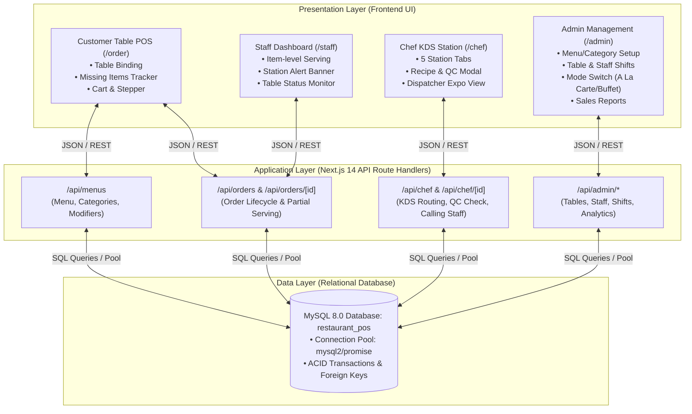
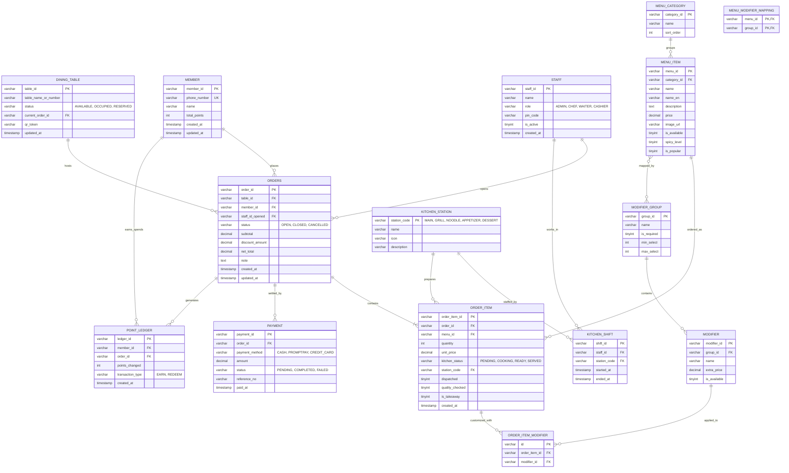
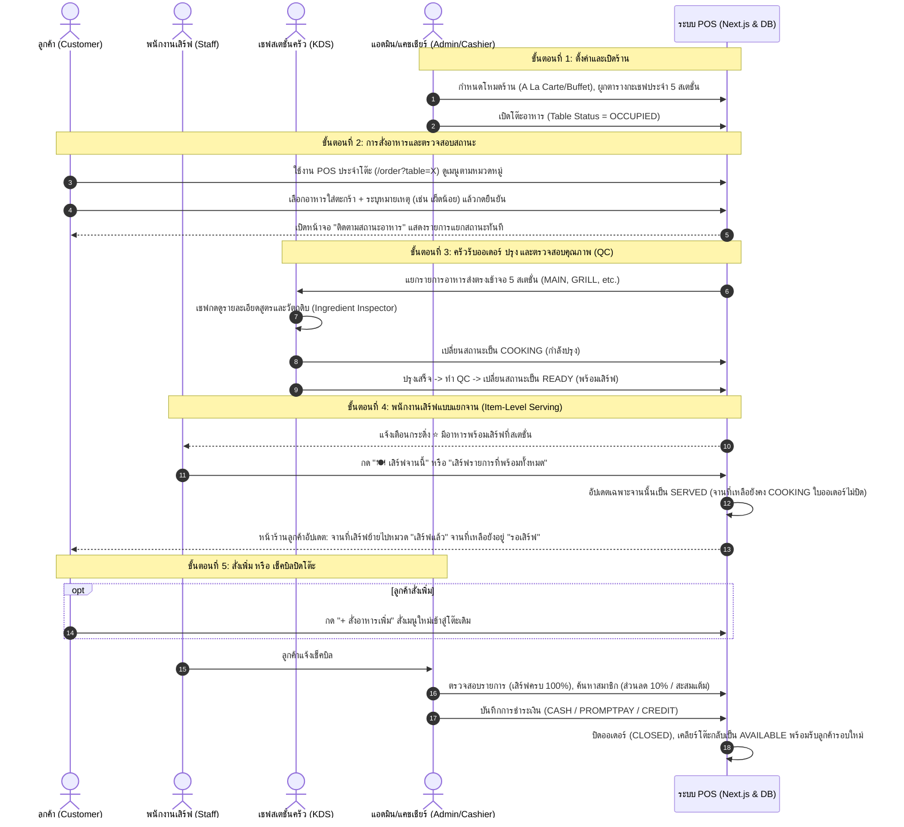

# 🍽️ Comprehensive Restaurant Management & POS System
## เอกสารการวิเคราะห์และออกแบบระบบ (System Analysis & Design Specification)
### ระบบบริหารจัดการร้านอาหารระดับภัตตาคารและบุฟเฟต์ (Smart Restaurant POS & KDS Solution)

[](https://nextjs.org/)
[](https://react.dev/)
[](https://www.mysql.com/)
[](https://tailwindcss.com/)
[]()
[]()

---

## 📖 1. บทนำและภาพรวมระบบ (Executive Summary & Overview)

ระบบ **Smart Restaurant POS & Kitchen Display System (KDS)** ถูกออกแบบขึ้นบนสถาปัตยกรรมแบบ **3-Tier Web Architecture** เพื่อรองรับการดำเนินงานของร้านอาหารระดับภัตตาคาร (Fine Dining / Casual Dining) ไปจนถึงร้านอาหารประเภทบุฟเฟต์ (Buffet) ที่ต้องการความถูกต้อง รวดเร็ว และการประสานงานแบบไร้รอยต่อระหว่าง **ลูกค้า (Customer)**, **เชฟประจำครัว (Kitchen Station)**, **พนักงานบริการหน้าร้าน (Staff/Waiter)** และ **ผู้ดูแลระบบ/แคชเชียร์ (Admin/Cashier)**

```
┌─────────────────────────────────────────────────────────────────────────────────────────┐
│                    Cloud-based Smart Restaurant POS Ecosystem                           │
├───────────────────┬───────────────────┬─────────────────────────┬───────────────────────┤
│ 📱 ลูกค้าประจำโต๊ะ │ 🧑‍💼 พนักงานบริการ │ 👨‍🍳 ในครัว (5 สเตชั่น) │ 👑 ผู้ดูแล/แคชเชียร์  │
│ (Customer POS)    │ (Floor Waitstaff) │ (Kitchen Station KDS)   │ (Admin & Cashier)     │
├───────────────────┼───────────────────┼─────────────────────────┼───────────────────────┤
│ • POS ล็อกประจำโต๊ะ│ • มอนิเตอร์โต๊ะ   │ • แยก 5 สเตชั่นอิสระ   │ • สลับ A La Carte/Buffet│
│ • ติดตามจานที่รอ  │ • เสิร์ฟแยกรายจาน │ • คุมกะไม่เกิน 2 คน/สถานี│ • จัดการเมนู/หมวดหมู่ │
│ • ตรวจสอบจานที่มา │ (Partial Serving) │ • ดูสูตร/วัตถุดิบ (QC)  │ • จัดกะเชฟเข้าสเตชั่น │
│ • สั่งเพิ่มได้ตลอด│ • แจ้งเตือนกระดิ่ง│ • กดเรียกพนักงานเสิร์ฟ  │ • คิดเงิน/ส่วนลดสมาชิก│
└───────────────────┴───────────────────┴─────────────────────────┴───────────────────────┘
```

### คุณลักษณะเด่นของระบบ:
1. **Tablet POS ประจำโต๊ะ**: เชื่อมต่อหมายเลขโต๊ะอัตโนมัติ สั่งอาหารได้ต่อเนื่อง ดูสถานะอาหารรายจานแบบเรียลไทม์ และตรวจสอบได้ทันทีว่า "รายการใดมาเสิร์ฟแล้ว" และ "รายการใดกำลังปรุง/ยังไม่มาเสิร์ฟ"
2. **KDS แยก 5 สเตชั่นครัว (Kitchen Station-Based)**: กระจายออเดอร์ไปยัง 5 สเตชั่นหลัก (`MAIN`, `GRILL`, `NOODLE`, `APPETIZER`, `DESSERT`) โดยไม่ผูกติดกับชื่อเชฟรายบุคคล แต่ควบคุมผ่านตารางกะเวร (จำกัดไม่เกิน 2 คนต่อสเตชั่น) มีระบบตรวจสอบสูตร/วัตถุดิบ และระบบตรวจคุณภาพอาหาร (Quality Check: QC) ก่อนเรียกพนักงาน
3. **การเสิร์ฟแบบแยกจาน (Item-Level Partial Serving)**: พนักงานสามารถเสิร์ฟอาหารจานที่เสร็จก่อน (เช่น เครื่องดื่มหรือออเดิร์ฟ) ได้ทันที โดยที่เมนูอื่นที่กำลังปรุงอยู่ **จะไม่หายไปจากระบบ** และใบออเดอร์จะเปิดค้างไว้จนกว่าจะเสิร์ฟครบ 100%
4. **ความยืดหยุ่นในการสลับโหมดร้าน (A La Carte ↔ Buffet)**: ผู้ดูแลระบบสามารถสลับรูปแบบร้านหรือกำหนดให้เปิดบริการทั้งสองรูปแบบพร้อมกันได้จากระบบแอดมินหลังบ้าน

---

## 🛠️ 2. สถาปัตยกรรมระบบและเทคโนโลยี (System Architecture & Tech Stack)

ระบบใช้สถาปัตยกรรมแบบ **3-Tier Modern Web Architecture** ที่รวมศูนย์การทำงานแบบ Server-Side และ Client-Side เข้าด้วยกัน



### สรุปเทคโนโลยีที่ใช้งาน (Technology Stack):
* **Frontend**:
  * **Framework**: Next.js 14 (App Router) + React 18
  * **Styling**: Tailwind CSS + CSS Modules (Dark / Light Theme Support)
  * **State & Sync**: React Hooks (`useState`, `useEffect`, `useCallback`, `useMemo`) ร่วมกับ Auto-Polling Mechanism (ตรวจสถานะออเดอร์อัตโนมัติทุก 4-5 วินาที)
* **Backend**:
  * **Runtime**: Node.js v22
  * **API Layer**: Next.js Server Route Handlers (`NextResponse`, RESTful API Architecture)
  * **DB Driver**: `mysql2/promise` (Connection Pooling: รองรับ Concurrent Connections สูง)
* **Database**:
  * **RDBMS**: MySQL 8.0 (`restaurant_pos`)
  * **Character Encoding**: UTF-8 (`utf8mb4_unicode_ci` รองรับภาษาไทยสมบูรณ์)
  * **Data Integrity**: Foreign Key Constraints, Transactions, Cascade / Restrict Rules

---

## 🎯 3. ขอบเขตของระบบและการสลับโหมด (System Scope: A La Carte vs. Buffet)

ระบบออกแบบมาเพื่อรองรับร้านอาหารระดับภัตตาคาร และมีความยืดหยุ่นสูงในการปรับเปลี่ยนโมเดลธุรกิจผ่านหน้า **Admin Dashboard**:

| มิติการทำงาน | โหมดภัตตาคาร (A La Carte Mode) | โหมดบุฟเฟต์ (Buffet Mode) |
| :--- | :--- | :--- |
| **การคิดราคา** | คิดราคาตามรายการอาหารที่สั่งจริงแต่ละจาน (`unit_price * quantity`) | คิดราคาเหมาต่อหัว (`head_price * number_of_guests`) ตามแพ็กเกจ (เช่น Standard, Premium, Gold) |
| **การสั่งอาหารบน POS** | สั่งได้ตามงบประมาณ แสดงยอดสุทธิสะสมต่อบิล | เมนูในแพ็กเกจจะสั่งได้ในราคา 0.- สั่งซ้ำได้ไม่อั้นตามรอบ |
| **การจำกัดเวลา** | ไม่จำกัดเวลานั่งทาน (ขึ้นอยู่กับรอบการจองโต๊ะ) | มีระบบจับเวลาถอยหลัง (Countdown Timer 90-120 นาที) เตือนก่อนหมดเวลา 15 นาที |
| **การจัดส่งเข้าครัว** | ส่งเข้าครัวตาม Course (Appetizer, Main, Dessert) | ส่งเข้าสเตชั่นครัวตามรอบการสั่ง (Batch Ordering) |
| **การจัดการของเหลือ** | ห่อกลับบ้านได้ (มีแฟล็ก `is_takeaway = 1`) | ห้ามนำกลับบ้าน มีระบบบันทึกค่าปรับอาหารเหลือ (Food Waste Fine) |
| **การเช็คบิล** | รวมค่าอาหาร + เครื่องดื่ม + Service Charge 10% + VAT 7% - ส่วนลดสมาชิก | รวมค่าหัวบุฟเฟต์ + เมนูพรีเมียมพิเศษ (Special Add-on) + ค่าปรับ (ถ้ามี) - ส่วนลด |

### กลไกการสลับโหมดจากระบบแอดมิน (Admin Mode Switching):
1. **Global Mode Switch**: แอดมินสามารถเปิดสวิตช์ระบบในหน้า `/admin` เพื่อเปลี่ยนร้านเป็นโหมด Buffet ทั้งร้าน (เช่น จัดโปรโมชั่นประจำเทศกาล)
2. **Table-Level Hybrid Switch**: แอดมินหรือพนักงานสามารถเลือกตอนเปิดโต๊ะ (`dining_table`) ได้ว่า โต๊ะนี้ทานแบบ A La Carte หรือเลือกแพ็กเกจ Buffet แบบใด ทำให้ในเวลาเดียวกันร้านสามารถรองรับลูกค้าได้ทั้ง 2 รูปแบบ

---

## 🗄️ 4. โครงสร้างฐานข้อมูล (Database Schema & Data Dictionary)

ฐานข้อมูล `restaurant_pos` ประกอบด้วย 15 ตารางที่ออกแบบตามหลัก Normalization (3NF) เพื่อความถูกต้องของข้อมูล:

### 1. แผนภาพความสัมพันธ์ข้อมูล (Entity-Relationship Diagram)



---

### 2. พจนานุกรมข้อมูลฉบับสมบูรณ์ (Complete Data Dictionary)

| ตาราง (Table) | คีย์หลัก / คีย์นอก | หน้าที่และคำอธิบาย |
| :--- | :--- | :--- |
| **`dining_table`** | PK: `table_id`<br>FK: `current_order_id` | ข้อมูลโต๊ะอาหาร สถานะการใช้งาน (`AVAILABLE`, `OCCUPIED`, `RESERVED`) และ `qr_token` ประจำโต๊ะ |
| **`orders`** | PK: `order_id`<br>FK: `table_id`, `member_id`, `staff_id_opened` | บันทึกออเดอร์หลัก ยอดรวม (`subtotal`), ส่วนลด (`discount_amount`), ยอดสุทธิ (`net_total`), สถานะ (`OPEN`, `CLOSED`, `CANCELLED`) |
| **`order_item`** | PK: `order_item_id`<br>FK: `order_id`, `menu_id`, `station_code` | รายการอาหารแต่ละจาน ควบคุมสถานะในครัว (`PENDING` ➔ `COOKING` ➔ `READY` ➔ `SERVED`), ธงตรวจคุณภาพ (`quality_checked`), และตัวเลือกกลับบ้าน (`is_takeaway`) |
| **`kitchen_station`** | PK: `station_code` | 5 สเตชั่นครัวหลัก ได้แก่ `MAIN` (จานหลัก), `GRILL` (เตาย่าง), `NOODLE` (เส้น/ต้ม), `APPETIZER` (ของทานเล่น/สลัด), `DESSERT` (ของหวาน/เครื่องดื่ม) |
| **`kitchen_shift`** | PK: `shift_id`<br>FK: `staff_id`, `station_code` | ตารางเข้ากะเวรของเชฟประจำสเตชั่น ควบคุมกฎจำกัดไม่เกิน 2 คนต่อสเตชั่นในเวลาเดียวกัน |
| **`menu_item`** | PK: `menu_id`<br>FK: `category_id` | รายการอาหาร ชื่อไทย/อังกฤษ คำอธิบาย ราคาปกติ รูปภาพ ระดับความเผ็ด และสถานะเปิด/ปิดขาย |
| **`menu_category`** | PK: `category_id` | หมวดหมู่อาหารหลักของร้าน พร้อมลำดับการแสดงผล (`sort_order`) |
| **`modifier_group`** | PK: `group_id` | กลุ่มตัวเลือกเสริม เช่น "ระดับความหวาน", "ความสุกของเนื้อ", "ท็อปปิ้ง" |
| **`modifier`** | PK: `modifier_id`<br>FK: `group_id` | ตัวเลือกย่อยแต่ละรายการ พร้อมราคาบวกเพิ่ม (`extra_price`) |
| **`menu_modifier_mapping`** | Composite PK/FK: `menu_id`, `group_id` | ตารางเชื่อมโยงกำหนดว่าแต่ละเมนูอาหารมีตัวเลือกเสริมกลุ่มใดบ้าง |
| **`order_item_modifier`** | PK: `id`<br>FK: `order_item_id`, `modifier_id` | ตัวเลือกเสริมที่ลูกค้าเลือกใส่ในอาหารแต่ละจานจริง |
| **`staff`** | PK: `staff_id` | พนักงานของร้าน พร้อมระบุบทบาท (`ADMIN`, `CHEF`, `WAITER`, `CASHIER`) และรหัส PIN |
| **`member`** | PK: `member_id`<br>UK: `phone_number` | ข้อมูลสมาชิกร้านอาหาร ยืนยันตัวตนด้วยหมายเลขโทรศัพท์ บันทึกแต้มสะสมรวม (`total_points`) |
| **`point_ledger`** | PK: `ledger_id`<br>FK: `member_id`, `order_id` | สมุดบัญชีประวัติแต้มสะสม ได้รับ (`EARN`) หรือใช้แลกส่วนลด (`REDEEM`) |
| **`payment`** | PK: `payment_id`<br>FK: `order_id` | บันทึกการชำระเงิน รองรับ `CASH`, `PROMPTPAY`, `CREDIT_CARD` และสถานะการชำระ |

---

## 👥 5. การวิเคราะห์ขั้นตอนการทำงานรายบทบาท (Workflow by Role: End-to-End)



---

### รายละเอียดหน้าที่ของแต่ละ Role:

### 1. 👑 ผู้ดูแลระบบและแคชเชียร์ (Admin / Cashier)
* **การตั้งค่าระบบและเมนู**:
  * เพิ่ม ลบ แก้ไข เมนูอาหาร หมวดหมู่ รูปภาพ ราคา ระดับความเผ็ด และตัวเลือกเสริม (Modifiers)
  * ตั้งค่าและปรับเปลี่ยนโหมดร้านอาหาร: **A La Carte** หรือ **Buffet** (กำหนดราคาต่อหัว, เวลาทาน)
* **การบริหารสเตชั่นครัวและกะพนักงาน**:
  * กำหนดและจัดกะการทำงานของเชฟลงใน 5 สเตชั่นหลัก (`kitchen_station`) ผ่านตาราง `kitchen_shift`
  * ควบคุมกฎความปลอดภัยในครัว: แต่ละสเตชั่นมีเชฟประจำกะได้ไม่เกิน 2 คน
* **การคิดเงินและปิดบิล (Cashier Functions)**:
  * เรียกดูยอดรวมสุทธิ คำนวณภาษีมูลค่าเพิ่ม (VAT) และค่าบริการ (Service Charge)
  * ค้นหาสมาชิกด้วยเบอร์โทรศัพท์ มอบส่วนลดสมาชิก และคำนวณแต้มสะสม (`point_ledger`)
  * บันทึกการชำระเงินผ่าน `payment` และเปลี่ยนสถานะโต๊ะจาก `OCCUPIED` กลับเป็น `AVAILABLE`

---

### 2. 🍽️ ลูกค้าประจำโต๊ะ (Customer via Table POS Tablet)
* **การระบุโต๊ะประจำเครื่อง**:
  * หน้าจอผูกกับโต๊ะอาหารอัตโนมัติผ่าน URL Parameter `?table=X` หรือบันทึกผ่าน Local Storage ไม่ต้องล็อกอินซ้ำซ้อน
* **การเลือกและสั่งอาหาร**:
  * ค้นหาและกรองเมนูตามหมวดหมู่อาหาร (Appetizer, Main, Noodle, Grill, Seafood, Dessert, Drink)
  * ปรับจำนวน เพิ่มลดจาน ใส่หมายเหตุพิเศษถึงครัว (เช่น ไม่ใส่ผักชี, หวานน้อย)
* **การติดตามสถานะแบบเรียลไทม์ (Live Order & Missing Items Tracker)**:
  * **หมวดที่ 1: รายการที่ยังไม่มาเสิร์ฟ**: แสดงจานที่รอคิว (`PENDING`), จานที่กำลังปรุง (`COOKING`) และจานที่ปรุงเสร็จกำลังนำมาส่ง (`READY`) พร้อมชื่อสเตชั่น
  * **หมวดที่ 2: รายการที่เสิร์ฟถึงโต๊ะแล้ว**: แสดงจานที่เสิร์ฟเรียบร้อยแล้ว (`SERVED`)
  * **สรุปตัวเลข 3 กล่อง**: แสดงจำนวนจานที่ยังขาด / เสิร์ฟแล้ว / ยอดรวมทั้งสิ้น
* **การสั่งอาหารเพิ่ม (+ Add More Items)**:
  * สามารถกดปุ่มสั่งอาหารเพิ่มได้ตลอดเวลาโดยไม่ต้องเรียกพนักงาน ออเดอร์ใหม่จะถูกส่งเข้าครัวและเชื่อมเข้ากับโต๊ะเดิมอย่างต่อเนื่อง

---

### 3. 👨‍🍳 เชฟประจำสเตชั่นครัว (Kitchen Station / KDS)
* **การแยกสเตชั่นอิสระ**:
  * หน้าจอ `/chef` แบ่งแท็บตามสเตชั่น: ครัวจานหลัก (`MAIN`), ครัวเตาย่าง (`GRILL`), ครัวเส้น/ต้ม (`NOODLE`), ครัวออเดิร์ฟ/สลัด (`APPETIZER`), ครัวของหวาน/เครื่องดื่ม (`DESSERT`)
  * เชฟไม่ต้องล็อกอินรายชื่อคนทำ ระบบตรวจสอบจากตารางกะเวรที่เริ่มทำงาน
* **คู่มือสูตรและวัตถุดิบ (Ingredient Inspector Modal)**:
  * เชฟสามารถกดที่เมนูเพื่อเปิดดูส่วนผสม วัตถุดิบ และวิธีปรุงอย่างละเอียด ป้องกันความผิดพลาดในเมนูที่ซับซ้อน
* **การควบคุมคุณภาพและการเรียกพนักงาน (Quality Check & Server Call)**:
  * เมื่อปรุงเสร็จ เชฟจะทำการตรวจสอบคุณภาพอาหาร (QC) ว่าหน้าตา รสชาติ และความสะอาดได้มาตรฐาน
  * กดปุ่มยืนยันผ่าน QC เพื่อเปลี่ยนสถานะเป็น `READY` ระบบจะส่งสัญญาณกระดิ่งเตือนพนักงานเสิร์ฟหน้าร้านทันที

---

### 4. 🏃 พนักงานบริการหน้าร้าน (Staff / Waiter)
* **หน้าจอมอนิเตอร์ออเดอร์หน้าร้าน (`/staff`)**:
  * มีป้ายแจ้งเตือนพิเศษ (Alert Banner) เรืองแสงเมื่อมีอาหารจานใดผ่านการตรวจคุณภาพจากเชฟแล้ว
  * ดูรายการออเดอร์แยกตามโต๊ะ สถานะ และเวลาที่สั่ง
* **การเสิร์ฟแยกรายจาน (Item-Level Partial Serving)**:
  * สามารถกดปุ่ม **"🍽️ เสิร์ฟจานนี้"** หรือ **"เสิร์ฟเฉพาะรายการที่พร้อม"**
  * ระบบจะอัปเดตเฉพาะจานที่ถูกนำไปเสิร์ฟให้เป็น `SERVED` ส่วนจานอื่นที่ยังปรุงอยู่จะคงสถานะเดิม
  * **แก้ปัญหาบั๊กเดิม**: ใบออเดอร์จะไม่ถูกปิด และเมนูอื่นจะไม่หายไปจากระบบจนกว่าอาหารทุกจานในโต๊ะนั้นจะเสิร์ฟครบ 100%

---

## ⚖️ 6. กฎทางธุรกิจและกรณีศึกษาสำคัญ (Critical Business Rules & Edge Cases)

1. **กฎการคงสถานะโต๊ะและออเดอร์ (Order & Table Retention Rule)**:
   $$\text{Order Status} = \begin{cases} \text{CLOSED}, & \text{เมื่อ } \sum (\text{kitchen\_status} \neq \text{'SERVED'}) = 0 \\ \text{OPEN}, & \text{เมื่อยังมีอาหารค้างส่ง } > 0 \end{cases}$$
   $$\text{Table Status} = \begin{cases} \text{AVAILABLE}, & \text{เมื่อไม่มีออเดอร์ใดในโต๊ะอยู่ในสถานะ OPEN} \\ \text{OCCUPIED}, & \text{เมื่อยังมีอย่างน้อย 1 ออเดอร์อยู่ในสถานะ OPEN} \end{cases}$$
2. **กฎความปลอดภัยสเตชั่นครัว (Station Safety & Staffing Rule)**:
   * ในแต่ละช่วงเวลา กะการทำงาน (`kitchen_shift`) จะอนุญาตให้มีเชฟประจำสเตชั่นเดียวกันได้สูงสุดไม่เกิน 2 คน เพื่อไม่ให้พื้นที่ครัวแออัด
3. **กฎการคำนวณเงินและสิทธิ์สมาชิก (Billing & Membership Rule)**:
   * ยอดสุทธิ = $(\text{Subtotal} - \text{Discount}) + \text{Service Charge (ถ้ามี)} + \text{VAT (ถ้ามี)}$
   * สมาชิกได้รับส่วนลด 10% อัตโนมัติเมื่อระบุเบอร์โทรศัพท์ที่ถูกต้อง
   * ทุกๆ 100 บาท จะได้รับคะแนนสะสม 1 คะแนน บันทึกลงใน `point_ledger`

---

## 🧭 7. แผนผังเส้นทางของระบบ (Key Application Routes)

| เส้นทาง (Route) | คำอธิบายหน้าจอการทำงาน |
| :--- | :--- |
| `/` | **หน้าแรก (Landing & Member Login):** สั่งอาหารทันที (Guest) หรือเข้าสู่ระบบสมาชิกด้วยเบอร์โทรศัพท์ |
| `/order` | **Customer Web POS:** เมนูอาหารประจำโต๊ะ เลือกระดับความเผ็ด ติดตามสถานะอาหารที่ยังไม่มาเสิร์ฟแบบเรียลไทม์ และสั่งอาหารเพิ่ม |
| `/chef` | **Kitchen Display System (KDS):** จอครัวแยก 5 สเตชั่น ดูสูตรวัตถุดิบ ตรวจสอบคุณภาพอาหาร (QC) และเรียกพนักงานเสิร์ฟ |
| `/staff` | **Staff Portal:** มอนิเตอร์ออเดอร์หน้าร้าน เสิร์ฟอาหารแยกจาน (Item-level Serving) และจัดการสถานะโต๊ะ |
| `/admin` | **Admin Dashboard:** จัดการเมนู, โต๊ะ, สเตชั่นครัว, จัดกะเชฟ, สลับโหมด A La Carte ↔ Buffet และรายงานยอดขาย |

---

## 🚀 8. บทสรุปและแนวทางการต่อยอด (Conclusion & Roadmap)

ระบบ Smart Restaurant POS & KDS นี้ถูกพัฒนาขึ้นมาอย่างสมบูรณ์แบบ ทั้งในด้าน **Database Design** ที่แข็งแกร่งเชื่อมโยงกับ MySQL จริง 15 ตาราง, **API Layer** ที่รองรับ Concurrent Transactions และ **Frontend UI/UX** ที่ตอบสนองต่อผู้ใช้งานจริงในร้านอาหารระดับภัตตาคาร โดยมีจุดเด่นสำคัญในการป้องกันอาหารตกหล่น และเปิดทางให้ร้านอาหารสามารถปรับเปลี่ยนรูปแบบการขายเป็นระบบบุฟเฟต์ หรือแบบผสมผสาน (Hybrid) ได้ทันทีจากระบบแอดมิน
